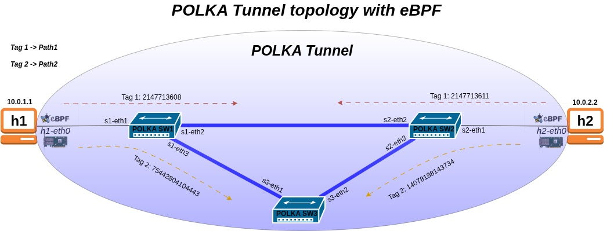

# polka-eBPF

## Building environment for eBPF:
### 1. To run, simply:
```
cd multpath_icmp/
sudo python3 m-eBPF_polka.py
```
```
mininet> h1 ping h2
mininet> h2 ping h1
```
### 2. POLKA implementation on the host using eBPF:
Source codes **encap_map-h _x_ .c** and **decap_h_x_.c** codes, respectively using tc anchored in the egress, and xdp.

To compile encap using maps (**encap_map_h _x_ .c**), a targeted compilation is required, which becomes:
```
sudo clang -O2 -g -target bpf -D__TARGET_ARCH_x86 -c encap_map_h1.c -o encap_map_h1.o
sudo clang -O2 -g -target bpf -D__TARGET_ARCH_x86 -c encap_map_h2.c -o encap_map_h2.o
```
And, to compile encap using maps (**decap_h_x_.c**), a targeted compilation is required, which becomes:
```
sudo clang -O2 -g -target bpf -D__TARGET_ARCH_x86 -c decap_h1.c -o decap_h1.o
sudo clang -O2 -g -target bpf -D__TARGET_ARCH_x86 -c decap_h2.c -o decap_h2.o
```

#### 3. Ex.: Loading values ​​into eBPF/TC maps encap_maps-h1.o:
0A 00 02 02 -> IP Address in hex
00 00 00 00 00 00 00 00 00 00 00 00 00 00 00 00 80 03 82 48 -> Polka key in hex (PATH 1)
00 00 00 00 00 00 00 00 00 00 00 00 00 00 44 9D 65 8A 1C FB -> Polka key in hex (PATH 2)

0A 00 01 01 -> IP Address in hex
00 00 00 00 00 00 00 00 00 00 00 00 00 00 00 00 80 03 82 4B -> Polka key in hex (PATH 1)
00 00 00 00 00 00 00 00 00 00 00 00 00 00 0C CD D5 67 44 76 -> Polka key in hex (PATH 2)

#### 3.1 - Filling in eBPF maps on host h1
```
h1 bpftool map update name ip_to_rtag_h1 key hex 0A 00 02 02 value hex 00 00 00 00 00 00 00 00 00 00 00 00 00 00 00 00 80 03 82 48
h1 bpftool map update name ip_tag_icmp_h1 key hex 0A 00 02 02 value hex 00 00 00 00 00 00 00 00 00 00 00 00 00 00 00 00 80 03 82 48
```
#### 3.2 - Filling in eBPF maps on host h2
```
h2 bpftool map update name ip_to_rtag_h2 key hex 0A 00 01 01 value hex 00 00 00 00 00 00 00 00 00 00 00 00 00 00 00 00 00 00 00 00
h2 bpftool map update name ip_tag_icmp_h2 key hex 0A 00 01 01 value hex 00 00 00 00 00 00 00 00 00 00 00 00 00 00 00 00 00 00 00 00
```

#### 4. Listing the contents of the maps:
```
h1 bpftool map dump name <map_name>
```
#### 5. Deleting map content:
```
h1 bpftool map delete name <map_name> key hex <key_map>
```

_ _**Note: In a Mininet emulation, it is necessary to create, for each host, a separate eBPF object file (e.g., `encap_map_h1.o` for `h1-eth0`, `encap_map_h2.o` for `h2-eth0`). For each object, a distinct map must also be created — for example, `ip_key_map_h1` for `h1-eth0` (`encap_map_h1.o`) and `ip_key_map_h2` for `h2-eth0` (`encap_map_h2.o`). This is required because the namespaces of `h1` and `h2` share the same maps; therefore, by using different names, each host/interface maintains its own independent map table.**_ _
